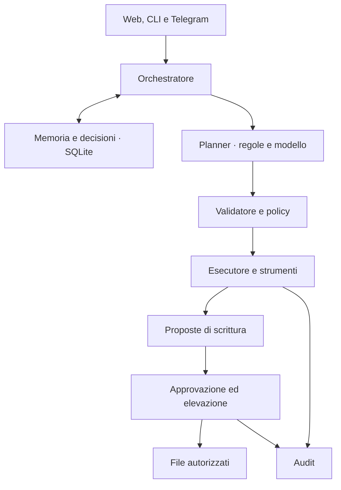

# TAUROS Cognitive OS

**Un ambiente personale per lavorare con l’AI, mantenendo memoria, strumenti e controllo delle operazioni.**

TAUROS collega una chat a modelli linguistici intercambiabili, memoria persistente e strumenti locali. Il suo obiettivo è dare continuità al lavoro: recuperare informazioni dai progetti autorizzati, organizzare decisioni e attività aperte, proporre interventi sui file e sottoporli a controlli prima dell’esecuzione.

> Il modello propone. La policy decide. L’esecutore agisce. L’audit registra.

Il nome “Cognitive OS” descrive l’architettura applicativa: TAUROS è un’applicazione Python con API e interfaccia web, non un sistema operativo da installare al posto di Windows, Linux o Android.

## Stato del progetto

La versione dichiarata nel pacchetto è **0.4.5**. Il repository contiene backend FastAPI, PWA, console operativa, CLI, integrazione Telegram e un Problem Agent opzionale. È un progetto in sviluppo: la presenza di un modulo o di un test non costituisce una certificazione di sicurezza o di idoneità alla produzione.

- [Verifiche e limiti di questa revisione](docs/VERIFICATION.md)
- [Visione](VISION.md) · [Cronologia](CHANGELOG.md) · [Licenza MIT](LICENSE)
- [Workflow dei test](https://github.com/Lucifer-AI-666/tauros-cognitive-os/actions/workflows/tests.yml)

## Cosa puoi fare

| Area | Implementazione presente |
| --- | --- |
| Conversazione | Chat web, API, CLI e streaming della risposta |
| Memoria | SQLite, ricerca, memorie candidate/confermate e separazione per utente |
| Continuità | Decisioni, attività aperte e brief |
| Strumenti locali | Informazioni di sistema, lettura e ricerca nei percorsi autorizzati; stato, log e diff Git |
| Pianificazione | Regole e planner LLM, validazione del piano e controlli per ogni passaggio |
| Scritture | Proposte, anteprima, approvazione, snapshot e verifica del risultato |
| Controllo | Livelli di privilegio, elevazione temporanea, audit e verifica della catena |
| Modelli | Adattatori Ollama, Groq, OpenAI/compatibili, Vertex AI e servizio DIB esterno |
| Problem Agent | Analisi e riformulazione delle richieste tramite `integrations/problem_agent` |
| Interfacce | PWA, console, Telegram opzionale e funzionalità vocali dipendenti dal browser |

La shell offline della PWA non esegue un modello sul telefono: per usare la chat serve un backend raggiungibile e un provider funzionante. Il servizio DIB e Ollama non vengono installati da questo repository.

## Architettura



`tauros/api.py` espone le interfacce HTTP; `orchestrator.py` coordina conversazione e strumenti; `planner.py`, `plan_validator.py` e `plan_executor.py` gestiscono i piani. `policy.py`, `privileges.py` e `security_paths.py` applicano i controlli. `writes.py` gestisce le scritture supervisionate. `brain.py` permette di cambiare provider/modello a runtime.

## Requisiti

- Python **3.11 o superiore** e Git per ottenere il codice.
- Un ambiente virtuale Python; eseguire i comandi dalla radice del repository.
- Per risposte AI: un provider configurato e raggiungibile. L’installazione non scarica modelli.
- Windows, Linux o macOS: gli script sono inclusi, ma la verifica di questa revisione è indicata nel rapporto, senza presumere test su tutti i sistemi.

## Installazione

Se il repository è privato, Git deve essere autenticato con un account autorizzato.

```bash
git clone https://github.com/Lucifer-AI-666/tauros-cognitive-os.git
cd tauros-cognitive-os
```

### Windows PowerShell

```powershell
python -m venv .venv
.\.venv\Scripts\python.exe -m pip install -e ".[dev]"
New-Item -ItemType Directory -Force "$HOME\TaurosWorkspace"
.\.venv\Scripts\tauros.exe init --owner "IlTuoNome" --allowlist "$HOME\TaurosWorkspace"
```

### Linux / macOS

```bash
python3 -m venv .venv
.venv/bin/python -m pip install -e '.[dev]'
mkdir -p "$HOME/TaurosWorkspace"
.venv/bin/tauros init --owner "IlTuoNome" --allowlist "$HOME/TaurosWorkspace"
```

`tauros init` crea `.env` e le cartelle dei dati, genera un token e lo mostra nel terminale: conservalo privatamente. Ripara token vuoti/deboli senza cambiare un token forte esistente, salvo `--rotate-token`. Quando l’installer ha già copiato il template, compila l’allowlist vuota; conserva un’allowlist già configurata.

Sono disponibili anche `install.ps1` e `install.sh`. Non autorizzare l’intera home se ti servono soltanto alcune cartelle di progetto.

## Configura il modello

Modifica `.env`, scegliendo **una** configurazione.

### Ollama locale

```dotenv
TAUROS_PROVIDER=ollama
TAUROS_MODEL=llama3.2:3b
TAUROS_OLLAMA_URL=http://127.0.0.1:11434
```

Ollama deve essere installato, avviato e avere già il modello indicato. I valori di default della classe `Settings` usano Ollama; il template `.env` e `tauros init` selezionano invece Groq. È quindi necessario controllare il file generato.

### Groq

```dotenv
TAUROS_PROVIDER=groq
TAUROS_MODEL=openai/gpt-oss-20b
TAUROS_GROQ_API_KEY=inserisci-la-tua-chiave
```

La disponibilità effettiva dei modelli dipende dal provider e dall’account. Il catalogo nel codice non è una verifica live. Con provider remoti, i contenuti inviati al modello lasciano il dispositivo.

OpenAI e gateway compatibili usano `TAUROS_OPENAI_API_KEY` e `TAUROS_OPENAI_BASE_URL`. Vertex usa credenziali ADC, `TAUROS_VERTEX_PROJECT` e `TAUROS_VERTEX_LOCATION`. Consulta [providers.py](tauros/providers.py) e [.env.example](.env.example).

**Cambio modello:** la console usa `/brain`. Se esiste `data/brain.json` (nella directory del database), il suo override viene caricato all’avvio e può prevalere su `.env`.

## Avvio e primo utilizzo

Attiva l’ambiente (`.venv\Scripts\Activate.ps1` su Windows, `source .venv/bin/activate` su Linux/macOS), poi:

```bash
tauros doctor
uvicorn tauros.api:app --host 127.0.0.1 --port 8000
```

| Indirizzo | Funzione |
| --- | --- |
| `http://127.0.0.1:8000/` | App: registrazione, login e chat |
| `http://127.0.0.1:8000/console` | Console operativa; usare il token API privato |
| `http://127.0.0.1:8000/health` | Stato del servizio; non prova da solo una risposta del modello |
| `http://127.0.0.1:8000/docs` | Documentazione interattiva delle API |

Per una prima prova senza modificare file, apri la console, autentica la sessione e chiedi: **“Dammi informazioni sul sistema”**. Per la chat libera serve anche il provider funzionante. Per la CLI: `tauros chat`.

Il login locale senza password e l’esposizione dell’OTP nella risposta API sono **disabilitati per default** in questa revisione. Per Google/Gmail occorre configurare il relativo servizio; per il login email serve SMTP. Le opzioni `TAUROS_LOCAL_CLICK_LOGIN` e `TAUROS_OTP_DEBUG` sono scorciatoie di sviluppo da attivare soltanto consapevolmente in un ambiente fidato.

## Permessi e dati

I livelli applicativi sono `BASE`, `OPERATOR`, `ADMINISTRATOR` e `CONTROLLED_ROOT`. Non equivalgono ai privilegi root/amministratore del sistema operativo e non aggiungono una shell arbitraria.

- Bind locale predefinito e filesystem limitato dai percorsi autorizzati.
- Elevazione temporanea: 15 minuti di default, massimo configurato 60.
- Scritture sottoposte a policy, approvazione ed eventuale conferma forte.
- `read_only` non è un blocco assoluto: il codice consente scritture supervisionate dopo elevazione ad amministratore.
- Database, backup e override del modello nella directory dati; `.env` contiene credenziali.
- Redazione dei segreti e audit sono difese applicative, non una garanzia contro ogni fuga di dati.

Non esporre direttamente il servizio su Internet. Gli esempi Docker/Caddy e Kubernetes richiedono una revisione specifica di autenticazione, proxy, volumi e permessi. Un proxy locale può alterare il significato dell’indirizzo del client: mantieni disabilitato il login locale senza password.

Questa revisione non attiva sincronizzazione tra dispositivi, abbinamento Wi-Fi o connettori GitHub/Vercel/Codacy. Il file `.codacy.yml` non dimostra che un account Codacy sia collegato.

## Test e sviluppo

```bash
python -m pytest -q
python -m compileall -q tauros
```

Il Problem Agent ha una suite separata:

```bash
cd integrations/problem_agent
python -m pytest -q
```

Le dipendenze di sviluppo si installano con `python -m pip install -e '.[dev]'`. Il workflow principale esegue la suite `tests/` su Python 3.12; non comprende automaticamente quella dell’integrazione. Per esiti, ambiente e controlli non eseguiti vedi [VERIFICATION.md](docs/VERIFICATION.md).

## Comandi utili

| Comando | Scopo |
| --- | --- |
| `tauros status` / `tauros doctor` | Configurazione e diagnostica |
| `tauros chat` / `tauros brief` | Conversazione e riepilogo |
| `tauros memories` / `tauros remember "testo"` | Consultazione e inserimento di memoria |
| `tauros migrate` | Migrazioni del database |
| `tauros backup` / `tauros backups` | Creazione ed elenco backup |
| `tauros restore PERCORSO` | Ripristino: modifica il database corrente |
| `tauros telegram` | Bot opzionale, dopo configurazione del token |

Per Telegram consulta [telegram_bot.py](tauros/telegram_bot.py); il collegamento utente usa `/link`. Token API, sessioni e token del bot non devono essere pubblicati.

## Risoluzione dei problemi

| Sintomo | Controllo |
| --- | --- |
| Token assente/debole | Esegui `tauros init`, poi riavvia il servizio |
| Lettura file negata | Verifica allowlist, blocklist, percorso e permessi del sistema operativo |
| Modello inatteso | Controlla `.env` e l’override `brain.json` |
| Provider non risponde | Controlla URL, credenziali e modello; con Ollama verifica il servizio locale |
| Codice email non ricevuto | Configura SMTP e controlla `sent`; non abilitare debug in produzione |
| UI assente dopo installazione wheel | Lavora dalla copia del repository: la wheel attuale include solo il package `tauros` |
| PWA offline | È disponibile la shell offline; chat e strumenti richiedono il backend |

## Organizzazione del repository

| Percorso | Contenuto |
| --- | --- |
| `tauros/` | Backend, policy, strumenti, memoria e CLI |
| `web/` | App, console, manifest, service worker e icone |
| `tests/` | Suite principale |
| `integrations/problem_agent/` | Modulo opzionale e propria suite |
| `config/` | Prompt di sistema |
| `scripts/` | Utilità operative, anche specifiche per Windows |
| `.github/workflows/` | Automazione dei test |
| `docs/` | Rapporto di verifica e incarico di revisione |
| `data/` | Dati creati a runtime, non da pubblicare |

I file `TAUROS_*.txt` e i documenti di consegna precedenti sono materiale storico: non sostituiscono verifiche sulla versione corrente.

## Contribuire

Descrivi il problema con passi riproducibili e log privi di credenziali. Proponi modifiche su un branch dedicato, aggiungi test per i comportamenti corretti e aggiorna la documentazione. Per segnalazioni di sicurezza usa un canale privato del manutentore, evitando dettagli sensibili in issue pubbliche.

## Licenza

[MIT](LICENSE), copyright Anouar Dib / TAUROS Cognitive OS. Vedi anche [NOTICE](NOTICE) e [dipendenze di terze parti](licenses/THIRD_PARTY.md). La licenza non viene modificata da questa revisione.
